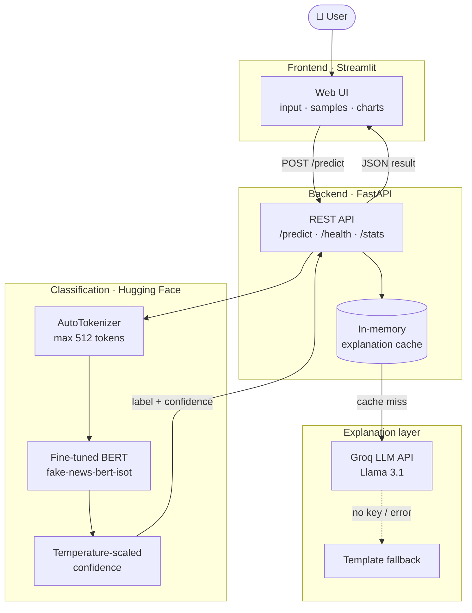
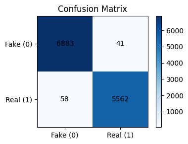
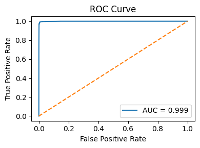

# 🔍 AI Fake News Detection System

A fake news detection system that pairs a fine-tuned **BERT** classifier with **LLM-generated explanations**, served through a **FastAPI** backend and an interactive **Streamlit** dashboard.


## 🛠️ Tech Stack


| Area | Tools |
|------|-------|
| **Language** | Python 3.10 |
| **Model** | BERT (`bert-base-uncased`) fine-tuned with Hugging Face Transformers + PyTorch |
| **Baselines** | scikit-learn (TF-IDF + Linear SVM / Logistic Regression / Random Forest / Naive Bayes), Keras LSTM |
| **Backend** | FastAPI, Uvicorn, Pydantic |
| **Frontend** | Streamlit, Plotly |
| **Explanations** | Groq API (`llama-3.1-8b-instant`) with a template-based fallback |
| **Data & Notebooks** | pandas, NumPy, Jupyter / Google Colab |
| **Deployment** | Render (`render.yaml`), PyInstaller (`exec.py`) |

## ✨ Features

### 🤖 Core Detection
- **BERT-based classification**: fine-tuned transformer that labels an article as `fake` or `real`
- **Confidence scoring**: temperature-scaled softmax probabilities for both classes
- **Label mapping safeguards**: explicit `id2label` / `label2id` mapping applied at load time, plus debugging scripts to detect swapped labels
- **GPU or CPU**: automatically uses CUDA when available

### 💡 AI Explanations
- **Groq-powered reasoning**: a Llama 3.1 model explains *why* the article was flagged
- **Text feature analysis**: checks for sensational language, source attribution, and similar signals to ground the explanation
- **Graceful fallback**: template-based explanation when no API key is configured
- **In-memory caching**: repeated requests reuse cached explanations

### 📊 Interactive Frontend
- **Streamlit web UI** with custom styling
- **Confidence gauge and class-score charts** built with Plotly
- **Sample articles** (real and fake) for one-click testing
- **Recent analyses** history in the sidebar

### 🧪 Research Work
- Data cleaning and merging of **LIAR, ISOT, WELFake, FEVER and an Indian fake news dataset** (221,220 rows after merging)
- Exploratory data analysis and label balancing
- Baseline ML models, an LSTM baseline, and BERT fine-tuning on multiple datasets

## 🏗️ System Architecture



### Data Flow

1. **Input**: the user pastes an article (or picks a sample) in the Streamlit UI
2. **Request**: the UI sends `POST /predict` to the FastAPI backend
3. **Classification**: the text is tokenized and passed through the fine-tuned BERT model
4. **Confidence**: logits are temperature-scaled and converted to class probabilities
5. **Explanation**: Groq generates a human-readable explanation (cached, with a template fallback)
6. **Display**: the UI shows the verdict, a confidence gauge, class scores, and the explanation

## 📊 Model Performance

### BERT (fine-tuned `bert-base-uncased`)

| Dataset | Accuracy | Notes |
|---------|----------|-------|
| **ISOT** (deployed model) | **~99.8%** | Macro F1 ≈ 0.998 on the held-out test split |
| ISOT / WELFake mix | 99.2% | F1 0.991, 5 epochs |
| LIAR | ~60.9% | Short political statements, a much harder task |

### Classical baselines (WELFake)

| Model | Accuracy |
|-------|----------|
| **Linear SVM** | **95.02%** |
| Logistic Regression | 94.32% |
| Random Forest | 93.55% |
| Multinomial Naive Bayes | 85.05% |

### Evaluation plots

| Confusion Matrix | ROC Curve |
|:---:|:---:|
|  |  |

> **Note:** ISOT is a relatively easy benchmark and near-perfect scores often do not carry over to unseen sources. The LIAR result shows how much harder real-world claim verification is.

## 📸 Screenshots

<!-- Add screenshots of the running app to a `screenshots/` folder, then uncomment:

| Home | Analysis Result |
|:---:|:---:|
|  |  |

-->

## 📁 Project Structure

```
Fake News Detection - NLP/
├── backend/                  # FastAPI service
│   ├── main.py               # API, BERT inference, Groq explanations
│   ├── debug_model.py        # Label-mapping diagnostics
│   ├── get_pred_debug.py     # Prediction debugging helper
│   ├── test_client.py        # Simple API test client
│   ├── requirements.txt
│   └── render.yaml           # Render deployment config
│
├── frontend/                 # Streamlit UI
│   ├── app.py
│   └── requirements/
│       ├── requirements.txt
│       └── .streamlit/config.toml
│
├── models/                   # Training notebooks
│   ├── 01_Baselines.ipynb
│   ├── 01_Baselines_Isot.ipynb
│   ├── 02_bert-model.ipynb
│   ├── 03_bert_liar_model.ipynb
│   ├── 04_bert_isot.ipynb
│   └── 05_Baseline_RNN.ipynb
│
├── notebooks/                # Data exploration and EDA
├── utils/                    # Result charts and baseline report
├── scrum/scrum_log.md        # Daily progress log
├── exec.py                   # One-command launcher (backend + frontend)
└── README.md
```

## 🚀 Quick Start

### Prerequisites

- Python 3.10+
- Internet access on first run (the BERT model is downloaded from the Hugging Face Hub)
- A free [Groq API key](https://console.groq.com) (optional, enables AI explanations)

### 1. Clone the repository

```bash
git clone https://github.com/<your-username>/<your-repo>.git
cd <your-repo>
```

### 2. Install dependencies

```bash
python -m venv venv
# Windows: venv\Scripts\activate    |    macOS/Linux: source venv/bin/activate

pip install -r backend/requirements.txt
pip install -r frontend/requirements/requirements.txt
```

### 3. Configure the API key (optional)

Create `backend/.env`:

```env
GROQ_API_KEY=your_groq_api_key
```

Without a key, the app still works and returns a basic template explanation.

### 4. Run the app

**Option A: one command**

```bash
python exec.py
```

This starts the backend on port 8000, the frontend on port 8501, and opens your browser.

**Option B: run each service separately**

```bash
# Terminal 1: backend
cd backend
python main.py

# Terminal 2: frontend
cd frontend
streamlit run app.py
```

| Service | URL |
|---------|-----|
| Streamlit UI | http://localhost:8501 |
| FastAPI backend | http://localhost:8000 |
| Interactive API docs | http://localhost:8000/docs |

## 📋 API Reference

| Method | Endpoint | Description |
|--------|----------|-------------|
| `GET` | `/health` | Model and explanation-service status |
| `POST` | `/predict` | Classify an article |
| `GET` | `/stats` | Model info and cache statistics |
| `GET` | `/docs` | Swagger UI |

### `POST /predict`

```json
{
  "text": "Your news article text here (minimum 20 characters)",
  "explain": true
}
```

**Response**

```json
{
  "text": "Your news article text here...",
  "prediction": "real",
  "confidence_score": 0.87,
  "raw_scores": { "fake": 0.13, "real": 0.87 },
  "explanation": "AI-generated explanation...",
  "processing_time": 0.42
}
```

## 🔧 Configuration

| Variable | Description | Required |
|----------|-------------|----------|
| `GROQ_API_KEY` | Enables Groq-generated explanations | No |

The classifier is set in `backend/main.py`:

```python
MODEL_NAME = "naheelkk/fake-news-bert-isot"
MAX_LENGTH = 512
```

## 🧪 Testing

```bash
cd backend
python test_client.py     # sends sample articles to the running API
python debug_model.py     # checks fake/real label mapping
```

Try these in the UI:

- **Likely fake:** *"Scientists have discovered that vaccines contain microchips designed to control people's minds through 5G networks."*
- **Likely real:** *"Apple Inc. reported quarterly earnings that exceeded analyst expectations, with revenue reaching $94.8 billion."*

## ⚠️ Limitations

- Predictions reflect patterns in the training data, not verified facts
- Performance on ISOT does not guarantee the same accuracy on other news sources
- Explanations are generated by an LLM and should be treated as guidance, not proof

Always verify important information with multiple trusted sources.

## 🔮 Future Improvements

- Real-time fact-check source lookup
- Multilingual support
- Docker setup for one-step deployment
- Evaluation on additional, more recent datasets

## 👤 Author

**Saifudeen K**
[GitHub](https://github.com/<your-username>) · [LinkedIn](<your-linkedin-url>)

## 📄 License

This project is licensed under the MIT License. Add a `LICENSE` file to the repository root to match.

## 🙏 Acknowledgments

- [Hugging Face](https://huggingface.co/) for Transformers and model hosting
- [Groq](https://groq.com/) for fast LLM inference
- [FastAPI](https://fastapi.tiangolo.com/) and [Streamlit](https://streamlit.io/)
- Datasets: LIAR, ISOT, WELFake, FEVER
